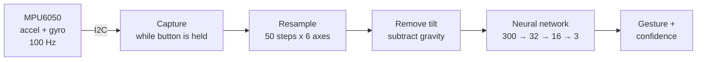
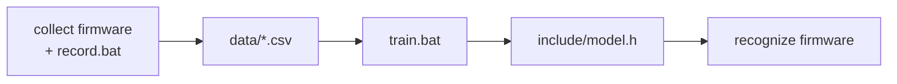

# ML Gesture Recognition

Real-time hand-gesture recognition on an ESP32, using a neural network that runs on the microcontroller itself. Hold a button, draw a gesture in the air, and the board tells you which one it was. No cloud, no phone, no ML runtime library.


## Highlights

- **On-device inference.** A small neural network runs on the ESP32. Inference is written from scratch in C++ (`src/nn.h`), with no TensorFlow Lite or other runtime.
- **Complete ML pipeline.** Record your own dataset on the board, train on your PC, export the weights as a C header, and flash them back.
- **Tiny model.** 10,211 parameters, about 40 KB of flash.
- **Robust to how a gesture is performed.** Recordings are time-normalised (fast and slow gestures look alike), tilt is removed (grip changes don't matter), and training augments the data with timing and size variations.
- **Hardware safety nets.** The firmware detects a sensor that reset after a loose wire and reconfigures it, ignores recordings with no movement, and the recorder survives a dropped USB connection.

## How it works



1. While the button is held, the MPU6050 is sampled at 100 Hz (accelerometer and gyroscope, 6 axes), for up to 3 seconds.
2. The recording is resampled to 50 time steps, giving 300 numbers no matter how long the gesture took.
3. The average acceleration (gravity) is subtracted, so the model learns the movement rather than how the board was tilted.
4. A fully connected network (ReLU hidden layers, softmax output) picks the gesture. Below 70% confidence the result is reported as unknown.

The same preprocessing is implemented in C++ on the board and in Python for training, and the exported model is checked against scikit-learn before it is written.

### Workflow



## Results

Trained on 90 recordings of 3 gestures (30 each), recorded with this hardware.

| Metric | Value |
| --- | --- |
| Gestures | circle, swipe, updown |
| Held-out test accuracy | 100% (23 recordings never seen in training) |
| Test accuracy with timing and size variations | 100% |
| Model | 300 → 32 → 16 → 3, 10,211 parameters |
| Flash used by the model | 39.9 KB |
| Sample rate | 100 Hz, 6 axes |


The test set is small, so treat these numbers as a sanity check. Live accuracy depends mostly on performing each gesture consistently (same grip, same direction).

## Hardware

| Part | Notes |
| --- | --- |
| ESP32 development board | Classic ESP32 DevKit, 30-pin (`esp32dev`) |
| GY-521 module | MPU6050 6-axis IMU |
| 4 jumper wires | Keep them short and firmly seated |

The BOOT button and the LED already on the ESP32 board are used as the record button and the status light.

### Wiring

| GY-521 | ESP32 |
| --- | --- |
| VCC | 3V3 |
| GND | GND |
| SCL | GPIO 22 |
| SDA | GPIO 21 |

XDA, XCL, AD0 and INT stay unconnected (AD0 open gives I2C address `0x68`).

The KiCad schematic is in [`hardware/`](hardware): open `hardware/ML-gesture-recognition.kicad_pro` in KiCad 10.

## Getting started

### Requirements

- [VS Code](https://code.visualstudio.com/) with the [PlatformIO](https://platformio.org/) extension
- Python 3 (the Windows scripts use the Python that ships with PlatformIO)

### Windows, no terminal

1. Double-click `setup.bat` once. It creates a private Python environment in `.venv` and installs the packages.
2. In VS Code, choose **env:collect** in the PlatformIO toolbar and click **Upload**.
3. Double-click `record.bat`, type a gesture name and record it about 30 times: hold BOOT, draw the gesture, release. Repeat for each gesture.
4. Double-click `train.bat`.
5. Choose **env:recognize**, click **Upload**, and open the **Serial Monitor**.

### Any OS, command line

```bash
pip install -r tools/requirements.txt

pio run -e collect -t upload
python tools/collect.py --label circle
python tools/collect.py --label swipe
python tools/collect.py --label updown

python tools/train.py

pio run -e recognize -t upload
pio device monitor
```

Close the serial monitor before recording: only one program can use the port at a time.

Example output:

```
Gestures: circle swipe updown
Ready. Hold the button, draw a gesture, release.
Gesture: circle (98%)  inference N us
```

## Adding your own gestures

1. Upload the `collect` firmware and record the new gesture under a new name. Each name becomes one CSV file in `data/`.
2. Run `train.bat` (or `python tools/train.py`). Every CSV file in `data/` becomes one class.
3. Upload the `recognize` firmware.
4. Put your own action for each gesture in `onGesture()` in `src/main_recognize.cpp`.

Tips: pick gestures that feel clearly different, hold the board the same way every time, and draw each gesture in the same direction.

## Configuration

Settings live in `include/config.h`.

| Setting | Default | Meaning |
| --- | --- | --- |
| `PIN_SDA`, `PIN_SCL` | 21, 22 | I2C pins |
| `PIN_BUTTON` | 0 | Record button (BOOT). Use 4 for an external button wired to GND |
| `MPU_ADDR` | `0x68` | `0x69` if AD0 is tied to 3V3 |
| `SAMPLE_RATE_HZ` | 100 | Sensor sample rate |
| `MAX_SAMPLES` | 300 | Longest gesture (3 s) |
| `N_STEPS` | 50 | Time steps the model sees |
| `MIN_CONFIDENCE` | 0.70 | Below this the gesture is reported as unknown |

Changing the sample rate, window or steps changes what the model sees, so record and train again afterwards.

## Project structure

```
src/
  main_collect.cpp      firmware 1: records gestures and prints them over serial
  main_recognize.cpp    firmware 2: runs the neural network on the board
  capture.cpp/.h        hold-to-record capture, movement check
  imu.cpp/.h            MPU6050 driver (no external library)
  gesture_features.h    resampling and tilt removal
  nn.h                  neural network inference
include/
  config.h              pins and settings
  model.h               trained weights (generated by train.py)
tools/
  collect.py            saves recordings to data/<gesture>.csv
  train.py              trains, evaluates and exports the model
data/                   recorded gestures
docs/                   training results
hardware/               KiCad schematic
setup.bat, record.bat, train.bat   Windows helpers
platformio.ini          two build environments: collect and recognize
```

## Troubleshooting

| Problem | Fix |
| --- | --- |
| `MPU6050 not found` | Check the four wires. If AD0 is tied to 3V3, set `MPU_ADDR = 0x69`. |
| `Sensor had restarted (loose wire?)` | A wire lost contact. Push the jumpers in firmly and keep them short. |
| `Brownout detector was triggered` | Weak USB power. Use a different cable or a port directly on the PC. |
| `Could not open COMx` / `Access is denied` | Close the serial monitor or any other program using the port. |
| `No movement, ignored` | Hold the board in your hand and move it while the button is held. |
| One gesture is often mistaken for another | Record more examples of it in the same grip you use live, then retrain. |

## Ideas for next steps

- Control media or lights with the gestures (BLE keyboard or Wi-Fi)
- Show the recognised gesture on a display
- Add an "other" class so random movements are rejected
- Continuous recognition without holding a button

## Author

Built by [AliStar-0](https://github.com/AliStar-0).
